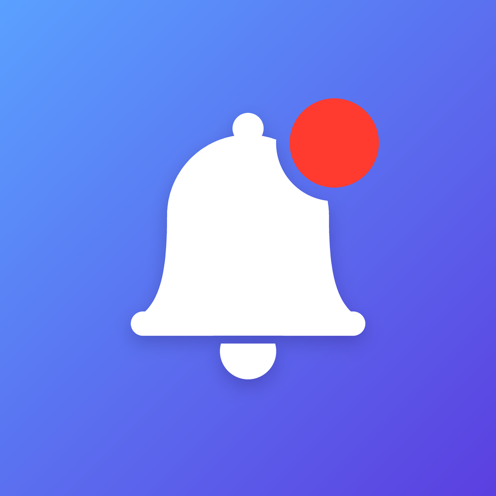

# Notif 🔔

Petite app iPhone (SwiftUI) : tu choisis combien de notifications tu veux recevoir et à quel intervalle, tu appuies sur **Lancer**, et ton iPhone les reçoit.

<p align="center"></p>

## Télécharger le .ipa

- **Lien direct (dernière version) :** https://github.com/ramphortpl/testapp/releases/latest/download/NotifApp.ipa
- Ou dans l'onglet **Actions** → dernier run « Build IPA » → artefact **NotifApp-ipa** (un .zip qui contient le .ipa).

Le .ipa est compilé automatiquement sur un Mac de GitHub à chaque push (voir [`.github/workflows/build-ipa.yml`](.github/workflows/build-ipa.yml)).

## Installer l'app sur l'iPhone

> ⚠️ Apple ne permet pas d'installer un .ipa non signé sur un iPhone (sans jailbreak). Il faut le signer avec ton identifiant Apple au moment de l'installation. Un identifiant Apple gratuit suffit.

### Avec Sideloadly (Windows ou Mac) — le plus simple

1. Installe [Sideloadly](https://sideloadly.io) sur ton ordinateur (sur Windows, installe aussi iTunes depuis le site d'Apple si Sideloadly le demande).
2. Branche l'iPhone en USB et accepte « Faire confiance à cet ordinateur ».
3. Glisse `NotifApp.ipa` dans Sideloadly, entre ton identifiant Apple, puis clique sur **Start**.
4. Sur l'iPhone : **Réglages → Confidentialité et sécurité → Mode développeur** → active-le (l'iPhone redémarre).
5. **Réglages → Général → VPN et gestion de l'appareil** → touche ton identifiant Apple → **Faire confiance**.
6. Ouvre l'app **Notif**, choisis le nombre et l'intervalle, appuie sur **Lancer** et autorise les notifications 🎉

Avec un identifiant Apple gratuit, l'app expire au bout de **7 jours** : il suffit de la réinstaller avec Sideloadly (tes réglages restent).

### Autres options

- **[AltStore](https://altstore.io)** ou **[SideStore](https://sidestore.io)** : même principe, l'app est signée avec ton identifiant Apple.
- **Tu as un Mac ?** Ouvre `NotifApp.xcodeproj` dans Xcode, choisis ton identifiant Apple dans *Signing & Capabilities → Team*, branche l'iPhone et clique sur ▶︎.
- **Compte Apple Developer payant** : l'app reste valide 1 an au lieu de 7 jours.

## Utilisation

- **Nombre de notifications** : boutons − / + (de 1 à 64, la limite d'iOS).
- **Intervalle** : boutons − / + pour la valeur, et **Secondes / Minutes / Heures** pour l'unité.
- **Lancer** : la première notification arrive après un intervalle, puis une autre à chaque intervalle. Exemple : 3 notifications toutes les 10 secondes arrivent après 10 s, 20 s et 30 s.
- **En cours** : nombre de notifications restantes et compte à rebours avant la prochaine. **Tout arrêter** annule celles qui ne sont pas encore arrivées.
- Tu peux fermer l'app ou verrouiller l'iPhone : les notifications arrivent quand même. L'app garde tes derniers réglages.

### La notification n'apparaît pas ?

- Vérifie **Réglages → Notifications → Notif** : « Autoriser les notifications » doit être activé.
- Désactive le mode **Concentration / Ne pas déranger**.

## Le code

| Fichier | Rôle |
| --- | --- |
| [`NotifApp/ContentView.swift`](NotifApp/ContentView.swift) | L'écran : choix du nombre et de l'intervalle, boutons Lancer et Tout arrêter |
| [`NotifApp/NotificationScheduler.swift`](NotifApp/NotificationScheduler.swift) | Programme et annule les notifications |
| [`NotifApp/IntervalUnit.swift`](NotifApp/IntervalUnit.swift) | Unités d'intervalle (secondes, minutes, heures) et textes associés |
| [`NotifApp/NotifAppApp.swift`](NotifApp/NotifAppApp.swift) | Point d'entrée de l'app ; affiche les notifications même quand l'app est ouverte |

Ce sont des notifications **locales** (`UNUserNotificationCenter`) : pas besoin de serveur ni de certificat push.

## Compiler soi-même (Mac avec Xcode 15 ou plus récent)

```sh
xcodebuild build -project NotifApp.xcodeproj -target NotifApp -configuration Release -sdk iphoneos \
  SYMROOT="$PWD/build" CODE_SIGNING_ALLOWED=NO
mkdir -p Payload && cp -R build/Release-iphoneos/NotifApp.app Payload/
zip -qry NotifApp.ipa Payload
```
